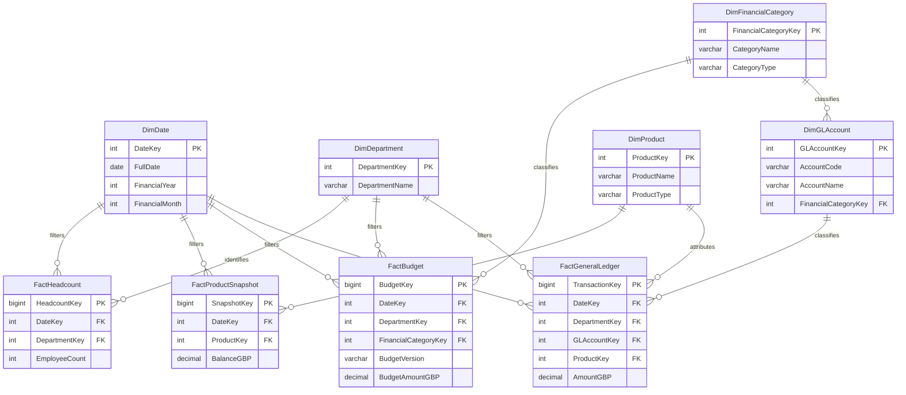

# Northbridge Building Society
## Data Model & Database Architecture

**Project:** Financial Performance & Profitability Intelligence  
**Project ID:** FPI-001  
**Document Version:** 2.0  
**Database:** Microsoft SQL Server

---

## 1. Purpose

This document describes the database structure and data model supporting the Northbridge Building Society financial reporting solution.

The objective is to create a structured data model that supports financial reporting, budget analysis and product performance reporting in Power BI.

The database will follow a simplified star schema, separating transactional and snapshot data from descriptive reference information.

## 2. Data Architecture

The proposed data flow is:

```text
Synthetic Source Data
        |
        v
   CSV Files
        |
        v
   SQL Server
        |
        v
 Data Preparation
        |
        v
 Dimensional Model
        |
        v
     Power BI
        |
        v
 Financial Dashboards
```

### Technology

| Component | Technology | Purpose |
|---|---|---|
| Data generation | Python | Create synthetic financial data |
| Source files | CSV | Store generated datasets |
| Database | SQL Server | Store and manage financial data |
| Transformation | SQL | Clean, validate and prepare data |
| Reporting | Power BI | Build dashboards and financial analysis |
| Version control | GitHub | Store scripts, documentation and project files |

## 3. Database Structure

The initial database will contain two main groups of tables:

**Fact tables:** Store financial transactions, budgets and reporting-date measurements.

**Dimension tables:** Provide descriptive information used to filter and analyse the facts.

The model will initially contain four fact tables and five dimension tables.

## 4. Proposed Data Model

### 4.1 Fact Tables

| Table | Description | Data grain |
|---|---|---|
| FactGeneralLedger | Financial transactions recorded by the organisation | One row per general ledger transaction line |
| FactBudget | Approved financial budgets | One row per month, department, financial category and budget version |
| FactProductSnapshot | Mortgage and savings portfolio balances | One row per reporting date and product |
| FactHeadcount | Employee numbers by department | One row per reporting date and department |

### 4.2 Dimension Tables

| Table | Description |
|---|---|
| DimDate | Calendar and financial reporting periods |
| DimDepartment | Organisational departments |
| DimProduct | Mortgage and savings products |
| DimGLAccount | General ledger accounts and account descriptions |
| DimFinancialCategory | Management reporting classifications for income and expenses |

## 5. Table Relationships

The fact tables will connect to the relevant dimension tables using foreign keys.

The proposed relationships are:

| Fact table | Dimension table | Relationship |
|---|---|---|
| FactGeneralLedger | DimDate | Many-to-one |
| FactGeneralLedger | DimDepartment | Many-to-one |
| FactGeneralLedger | DimGLAccount | Many-to-one |
| FactGeneralLedger | DimProduct | Many-to-one, where product attribution exists |
| FactBudget | DimDate | Many-to-one |
| FactBudget | DimDepartment | Many-to-one |
| FactBudget | DimFinancialCategory | Many-to-one |
| FactProductSnapshot | DimDate | Many-to-one |
| FactProductSnapshot | DimProduct | Many-to-one |
| FactHeadcount | DimDate | Many-to-one |
| FactHeadcount | DimDepartment | Many-to-one |

`DimGLAccount` will contain a reference to `DimFinancialCategory`, allowing financial transactions to be classified for management reporting.

Budget records will reference `DimFinancialCategory` directly.

### Logical Data Model

The following diagram illustrates the proposed relationships.



This is a logical representation of the database. The physical SQL Server implementation may include additional technical columns such as load timestamps and source identifiers.

## 6. Key Data Fields

The following fields represent the minimum information required for the initial database.

### DimDate

| Field | Data type | Description |
|---|---|---|
| DateKey | INT | Primary key in YYYYMMDD format |
| FullDate | DATE | Calendar date |
| CalendarYear | INT | Calendar year |
| CalendarMonth | INT | Calendar month number |
| MonthName | VARCHAR(20) | Month name |
| FinancialYear | VARCHAR(10) | Financial year, e.g. FY2024 |
| FinancialMonth | INT | Financial month, April = 1 and March = 12 |

### DimDepartment

| Field | Data type | Description |
|---|---|---|
| DepartmentKey | INT | Primary key |
| DepartmentName | VARCHAR(100) | Department name |

Example departments:

- Mortgage Lending
- Savings
- Finance
- Operations
- Technology
- Marketing
- Risk & Compliance

### DimProduct

| Field | Data type | Description |
|---|---|---|
| ProductKey | INT | Primary key |
| ProductName | VARCHAR(100) | Product name |
| ProductType | VARCHAR(50) | Mortgage or Savings |
| ProductCategory | VARCHAR(50) | Fixed Rate, Tracker, Easy Access, Cash ISA, etc. |

### DimGLAccount

| Field | Data type | Description |
|---|---|---|
| GLAccountKey | INT | Primary key |
| AccountCode | VARCHAR(20) | General ledger account code |
| AccountName | VARCHAR(100) | General ledger account description |
| FinancialCategoryKey | INT | Reference to DimFinancialCategory |

### DimFinancialCategory

| Field | Data type | Description |
|---|---|---|
| FinancialCategoryKey | INT | Primary key |
| CategoryName | VARCHAR(100) | Reporting category |
| CategoryType | VARCHAR(30) | Income or Expense |

Example categories:

- Interest Income
- Interest Expense
- Non-interest Income
- Personnel Costs
- Technology Costs
- Property Costs
- Marketing Costs
- Other Operating Costs

### FactGeneralLedger

| Field | Data type | Description |
|---|---|---|
| TransactionKey | BIGINT | Primary key |
| DateKey | INT | Reference to DimDate |
| DepartmentKey | INT | Reference to DimDepartment |
| GLAccountKey | INT | Reference to DimGLAccount |
| ProductKey | INT | Optional reference to DimProduct |
| AmountGBP | DECIMAL(18,2) | Reporting amount in GBP |
| SourceTransactionID | VARCHAR(50) | Original transaction identifier |

The `AmountGBP` field will use a consistent management reporting convention:

- Income is stored as a positive value.
- Expenses are stored as a positive value.

The original accounting debit and credit information may be retained in the source dataset for validation and reconciliation.

### FactBudget

| Field | Data type | Description |
|---|---|---|
| BudgetKey | BIGINT | Primary key |
| DateKey | INT | Reference to DimDate |
| DepartmentKey | INT | Reference to DimDepartment |
| FinancialCategoryKey | INT | Reference to DimFinancialCategory |
| BudgetVersion | VARCHAR(30) | Budget version |
| BudgetAmountGBP | DECIMAL(18,2) | Approved budget amount |

The initial budget grain is one record per month, department, financial category and budget version.

### FactProductSnapshot

| Field | Data type | Description |
|---|---|---|
| SnapshotKey | BIGINT | Primary key |
| DateKey | INT | Reference to DimDate |
| ProductKey | INT | Reference to DimProduct |
| BalanceGBP | DECIMAL(18,2) | Outstanding product balance |

The table will contain both mortgage and savings product balances.

Each record represents the balance of a product at a particular reporting date.

### FactHeadcount

| Field | Data type | Description |
|---|---|---|
| HeadcountKey | BIGINT | Primary key |
| DateKey | INT | Reference to DimDate |
| DepartmentKey | INT | Reference to DimDepartment |
| EmployeeCount | INT | Number of employees |

This table supports basic organisational analysis and may be used for additional metrics such as cost per employee in a future enhancement.

## 7. Data Modelling Principles

The following principles will guide implementation.

### 7.1 Separate Fact Tables

Actual financial transactions, budgets and portfolio snapshots will remain in separate fact tables.

This prevents incorrect aggregation and avoids mixing different types of financial measurements.

### 7.2 Shared Dimensions

Dimensions such as Date and Department will be reused across fact tables where appropriate.

This allows consistent filtering and analysis across different reporting areas.

### 7.3 Avoid Direct Fact-to-Fact Relationships

Fact tables should not be joined directly to one another.

Relationships should be established through shared dimensions.

For example, actual and budget figures can be compared using shared date, department and financial category dimensions.

### 7.4 Portfolio Snapshots

Mortgage and savings balances represent the position at a specific reporting date.

Balances from different months must not be added together to calculate portfolio value.

### 7.5 Product Attribution

Product income and costs will be analysed where reliable product attribution exists in the general ledger.

Where income or expenses cannot be attributed to a specific product, they will remain unallocated rather than being assigned arbitrarily.

## 8. Data Quality Checks

The following checks will be implemented during data preparation and loading.

| ID | Validation |
|---|---|
| DQ01 | Primary keys must be unique. |
| DQ02 | Foreign keys must reference valid dimension records. |
| DQ03 | Transaction dates must exist in DimDate. |
| DQ04 | Financial amounts must be valid numeric values. |
| DQ05 | All general ledger accounts must map to a financial category. |
| DQ06 | Budget records must not contain duplicate records at the defined grain. |
| DQ07 | Product snapshots must contain valid reporting dates and products. |
| DQ08 | Product balances must be non-negative unless an exception is documented. |
| DQ09 | General ledger totals must reconcile to source data. |
| DQ10 | Actual and budget records must use consistent financial categories. |

## 9. SQL Implementation Standards

The database will follow these basic implementation standards:

- Use primary keys to uniquely identify records.
- Use foreign keys to enforce relationships.
- Use `DECIMAL(18,2)` for monetary values.
- Use `DATE` for reporting dates.
- Use integer date keys in `YYYYMMDD` format.
- Use consistent naming conventions for tables and columns.
- Use appropriate indexes on primary keys and commonly queried foreign keys.
- Retain source identifiers where useful for reconciliation.

The database should be designed to support the initial reporting requirements without unnecessary complexity.

## 10. Future Enhancements

The data model may be extended later to support:

- Financial forecasting.
- Cash flow analysis.
- More detailed product profitability.
- Cost allocation.
- Supplier and operational expenditure analysis.
- Additional financial and operational KPIs.

These enhancements will only be introduced if they provide meaningful value to the project.

## 11. Implementation Sequence

The proposed implementation order is:

1. Create the SQL Server database.
2. Create the five dimension tables.
3. Populate the dimensions with reference data.
4. Create the four fact tables.
5. Generate and load synthetic datasets.
6. Run data quality and reconciliation checks.
7. Create SQL queries for financial analysis.
8. Connect the database to Power BI.
9. Build the financial dashboards.

---

**Document status:** Initial logical data model approved for portfolio development.
